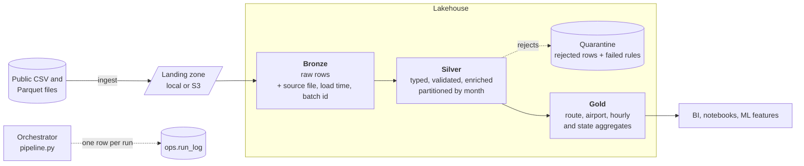

# Flight Lakehouse

[](https://github.com/chtanzeel/flight-lakehouse/actions/workflows/ci.yml)


A medallion (bronze, silver, gold) data pipeline on **PySpark and Delta Lake** that turns 3 million raw
flight records into validated, analysis-ready tables. It runs on a laptop with one command and moves
to **Databricks and S3** by changing two paths.

The point of the project is the engineering around the transformations: a data quality contract with
a quarantine for bad rows, a row-count reconciliation gate, lineage columns, an audit log of every
run, idempotent re-runs, and a test suite that runs in CI.

## Architecture



| Layer | Tables | What happens |
| --- | --- | --- |
| Bronze | `flights`, `airports` | Source data stored as it arrived, plus `_source_file`, `_ingested_at`, `_batch_id` |
| Silver | `flights`, `flights_quarantine`, `airports` | Types cast, codes normalised, six quality rules applied, airports joined in, partitioned by `flight_month` |
| Gold | `route_performance_monthly`, `airport_daily`, `hourly_delay_profile`, `origin_state_monthly` | Business aggregates: delay percentiles, delayed share, a 7-day rolling average per airport |
| Ops | `run_log` | Status, timings and metrics of every run, including failed ones |

## Results

Full run on the real 3M-row dataset (US flights, January to June 2001 plus six rows on 1 July), on a 2-core, 8 GB machine:

| Stage | Rows out | Time |
| --- | --- | --- |
| Bronze | 3,000,000 flights, 3,376 airports | 11 s |
| Silver | 2,999,989 valid, 11 quarantined (all `delay_within_bounds`) | 26 s |
| Gold | 19,497 route-months, 39,952 airport-days, 24 hours, 312 state-months | 21 s |

Row counts reconcile exactly (2,999,989 + 11 = 3,000,000), and the gold tables were cross-checked
against an independent pandas calculation on the raw file.

A few things the gold layer shows:

- **Delays build through the day.** The average delay goes from about -3 minutes for 5am to 6am
  flights to 17.6 minutes at 9pm, and the share of flights that are 15+ minutes late rises from 5% to 34%.
  The few flights timestamped after midnight are the worst (43.5 minutes on average in the midnight hour).
- **Highest delayed share by origin state** (states with 50k+ flights): MA 25.9%, WA 25.1%, IL 24.6%.
  The lowest are TN 16.9% and OH 17.4%. Overall, 20.9% of flights were delayed.
- **Busiest origins:** ORD (166k), DFW (157k) and ATL (125k) departures.

## Quick start

Requirements: Python 3.10+ and Java 17+ (Spark needs a JVM).

```bash
git clone https://github.com/chtanzeel/flight-lakehouse.git
cd flight-lakehouse
make setup     # virtualenv + dependencies
make run       # download the data, then run bronze -> silver -> gold
```

Output lands in `data/lake/<layer>/<table>`. The run prints a JSON summary with per-stage row counts
and timings. To inspect a table:

```python
spark.read.format("delta").load("data/lake/gold/hourly_delay_profile").show(24)
```

Run a single stage or switch formats:

```bash
.venv/bin/python -m flight_lakehouse.pipeline --stages silver gold
TABLE_FORMAT=parquet make run      # skip Delta, e.g. when offline
```

Settings can be overridden with environment variables: `LAKEHOUSE_ROOT`, `LAKEHOUSE_LANDING`,
`TABLE_FORMAT`, `MIN_DELAY_MINUTES`, `MAX_DELAY_MINUTES`, `MAX_QUARANTINE_RATIO`.

## Design decisions

**Bad rows are quarantined, not dropped.** Each silver row must pass six rules (valid timestamp, IATA
codes for both airports, origin differs from destination, positive distance, delay within
-120 to 1440 minutes). A row that fails goes to `silver.flights_quarantine` with the *names of every
rule it broke*, so problems can be inspected and replayed. A NULL check result counts as a failure.

**A reconciliation gate stops silent data loss.** Every input row must land in exactly one place,
silver or quarantine. If the counts do not add up, or more than 1% of rows are rejected, the run
fails loudly instead of publishing partial data.

**Bronze stays raw.** Airports are read with every column as a string; typing happens in silver, so
a bad source value is a quality finding rather than a schema failure at load time.

**Re-runs are idempotent.** Each stage is a full overwrite, so running twice gives the same tables.
Every run, successful or not, appends a row to `ops.run_log` with its batch id and metrics.

**The rolling average is correct, not just convenient.** The 7-day rolling delay in `airport_daily`
uses a range window over calendar days (so gaps in the data do not pull in older days) and divides
total delay minutes by total flights, rather than averaging daily averages, which would over-weight
quiet days. Both properties are covered by tests.

**Small things that matter at scale.** The airport dimension is broadcast-joined instead of shuffling
3M flight rows, silver is partitioned by month, and the session is pinned to UTC so results do not
depend on the machine's timezone.

**Known choice: exact duplicates are kept.** 191 rows share an identical timestamp, route, distance
and delay. The data has no flight id, so they could be distinct flights; dropping them would be a guess.
This is the first thing to revisit if a source key becomes available.

The source `date` column is treated as the departure time; the dataset does not document it further.

## Testing

```bash
make test         # 26 tests on Parquet tables, no extra downloads
make test-delta   # the same suite on Delta Lake tables
make lint
```

The tests use small hand-checked datasets: quality rules (including NULL handling and multi-rule
failures), silver cleaning and enrichment, gold calculations with known answers, and pipeline
behaviour (lineage columns, idempotency, run log, a failing quality gate). GitHub Actions runs lint
and the suite for both table formats on every push.

## Running on Databricks and AWS

See [docs/databricks-aws.md](docs/databricks-aws.md) for the S3 layout, cluster setup and scheduling.
`databricks/run_pipeline.py` is a ready-to-import notebook with widgets for the lake root, landing
folder and table format.

## Project layout

```
src/flight_lakehouse/
  config.py         settings and environment overrides
  spark_session.py  local / CI / Databricks session factory
  ingest.py         download source files with retries
  quality.py        rule engine, quarantine split, reconciliation gate
  bronze.py  silver.py  gold.py   the three layers
  pipeline.py       orchestration, metrics, run log, CLI
tests/              pytest suite (26 tests)
databricks/         notebook entry point
docs/               deployment guide
.github/workflows/  CI
```

## Data

Flight delays from the [vega-datasets](https://github.com/vega/vega-datasets) repository
(`flights-3m.parquet`, `airports.csv`). Data is downloaded at run time and is not stored in this repo.

## Next steps

- Incremental loads: Auto Loader into bronze and `MERGE` into silver instead of full refresh
- Data quality metrics published to a dashboard
- Terraform for the S3 bucket and IAM role
